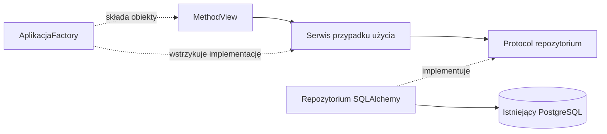

# Architektura i decyzje

## Ustalone

Flask będzie obsługiwał stronę i administrację. Nowa aplikacja powstaje w `handball_datascience`. Starszy serwis w katalogu nadrzędnym nie jest szkieletem nowej aplikacji.

Inspekcja 2026-09-12 potwierdziła PostgreSQL 15.1, bazę `zprp` na `localhost:5432`, użytkownika `postgres` oraz schematy `public` i `logs`. [Dokumentacja rzeczywistej bazy](database/README.md) jest punktem odniesienia dla zapytań. [Archiwalny plik schema_postgres.sql](database/schema_postgres_archive.sql) (kopia wcześniejszego projektu bazy z katalogu nadrzędnego, stan 2026-09-10) jest wcześniejszym projektem i różni się od bazy. Nie wykonuj go w celu nawiązania połączenia.

Decyzja użytkownika z 2026-09-12: AI nie zmienia bazy samodzielnie. Jakikolwiek zapis, zmiana struktury lub administracja bazą wymagają wyraźnej prośby o daną zmianę. Sama implementacja Flaska nie upoważnia do migracji ani zapisu. Do inspekcji używamy transakcji tylko do odczytu, bez zmiany globalnej konfiguracji PostgreSQL.

## Przyjęty podział obiektowy

Decyzja z 2026-09-12: cały nowy kod aplikacyjny powstaje obiektowo i zgodnie z SOLID. Aktualizacja nazewnictwa z 2026-09-14: pliki, katalogi, moduły i pakiety są angielskie; domena, metody i zmienne polskie bez znaków diakrytycznych, a role techniczne klas angielskie, np. MeczService i MeczRepository. Zachowujemy oryginalne API bibliotek i jawne mapowanie rzeczywistych nazw bazy. Przyjęty stos oraz uzasadnienie: [TECH_STACK](TECH_STACK.md). Wymagania implementacji: [CODING_STANDARDS](CODING_STANDARDS.md).

- AplikacjaFactory i Ustawienia składają aplikację oraz konfigurację. Cienki adapter create_app() obsługuje integrację z narzędziami Flaska.
- Klasy MethodView w Blueprints obsługują HTTP; szablony Jinja2 odpowiadają za prezentację.
- Klasy serwisów realizują przypadki użycia i logikę meczową.
- Kontrakty Protocol oddzielają serwisy od klas repozytoriów SQLAlchemy. Zależności przekazujemy przez konstruktor.
- Typowane modele SQLAlchemy 2.0 mapują istniejące tabele, a obiekty dataclass przenoszą filtry i wyniki.
- Flask-SQLAlchemy zarządza integracją silnika i sesji; sterownikiem PostgreSQL jest psycopg 3.
- Późniejszy eksporter będzie klasą korzystającą z tej samej logiki przypadków użycia.

Przepływ zależności:

Warstwy dla listy meczów są zaimplementowane; kolejne funkcje rozwijają ten podział. Twórz klasy potrzebne konkretnej funkcji, bez pustych warstw i ogólnych repozytoriów CRUD na zapas.

Projekt modułów: [DIRECTORY_STRUCTURE](DIRECTORY_STRUCTURE.md). Diagramy klas, składania zależności i obsługi żądania: [UML](UML.md). Istniejący pakiet aplikacji to `src/handball/`; przemianowanie kodu i odwołań wykonano 2026-09-14.

## Niezależność od języka bazy i interfejsu

Decyzja z 2026-09-14: język nazw domenowych nie wynika z języka tabel i kolumn. ORM mapuje fizyczny schemat, a repozytoria realizują kontrakty serwisów i zwracają obiekty domenowe. Przyszła baza z angielskimi nazwami może wymagać nowego mapowania i zapytań, przy zachowaniu polskiej domeny. Zmiany znaczenia danych wymagają osobnej analizy i testów; nie zakładamy automatycznej wymienności baz.

Nowy interfejs WWW może być kolejnym adapterem tych samych serwisów. Logika nadal nie zależy od Flask request, current_app ani sesji ORM. Nie tworzymy teraz dodatkowych adapterów ani migracji na zapas.

Nazwy klas i ścieżek w dokumentacji odpowiadają migracji z 2026-09-14. Pakiet dystrybucyjny i importowany to `handball`, testy są w `tests`, a skrypt startowy to `run.bat`. Flask jawnie wskazuje `interface/templates` i `interface/static`. Zachowano adresy `/administracja/`, `/administracja/mecze` i prefiks zasobów `/statyczne`; pliki zasobów nazywają się `admin.css` i `admin.js`.

## Decyzje otwarte

| Temat | Kiedy rozstrzygnąć |
| --- | --- |
| Dokładne wersje poprawek i konfiguracja narzędzi | Przy szkielecie: rozwiązanie zależności uv na Pythonie 3.13, zapis uv.lock i wspólne sprawdzenie |
| Integracja połączenia z Flaskiem | Parametry i schemat są rozpoznane; do przygotowania konfiguracja aplikacji bez sekretów w MD |
| Źródło kont, role i operacje administracyjne | Przed implementacją panelu; biblioteką sesji użytkownika będzie Flask-Login |
| Własne tabele aplikacji i migracje | Gdy pojawi się potrzeba trwałego zapisu |
| Format eksportu i hosting | Przy rozpoczęciu etapu publicznego serwisu |

## Warunki implementacji

Start aplikacji nie może importować danych, tworzyć tabel ani uruchamiać migracji w istniejącej bazie. Repozytoria odczytu korzystają z transakcji READ ONLY; sesji nie współdzielimy między żądaniami. Parametry zapytań muszą być przekazywane przez mechanizm sterownika/ORM; sortowanie wybierane z dopuszczonych pól. Zapytania listujące powinny mieć limit i stabilny porządek.

Przed udostępnieniem administracji wymagane są uwierzytelnienie, kontrola uprawnień oraz ochrona formularzy zmieniających stan. Pola pochodzące ze źródeł danych wymagają bezpiecznego renderowania. Eksport publiczny powinien mieć jawny zestaw pól, zamiast kopiować całe rekordy bazy.

Istotną rozstrzygniętą decyzję zapisuj tutaj z datą, powodem i skutkami. Osobny ADR dodawaj dopiero, gdy uzasadnienie jest zbyt obszerne dla tego dokumentu.

## Oddzielenie prezentacji od danych — 2026-09-19

Repozytorium odczytu meczów zwraca typowane obiekty domeny z wartościami liczbowymi, datami i brakami danych. Nie formatuje tekstów wyniku, etykiet tabel ani kolorów. `domain/match_rules.py` zawiera `MeczPolicy`: zmianę stron, status, obecność dogrywki i serii karnych oraz maksimum bramek w składzie.

`interface/presenters/match_presenter.py` przygotowuje listę i szczegóły do renderowania, używając reguł domenowych. `interface/view_models/matches.py` zawiera odrębne dataclass z tekstami i wyróżnieniami. `kolor_pozycji` i `najlepszy_strzelec` nie są już polami danych zawodnika w domenie. Presentery otrzymują zależności przez konstruktor; składa je `ZaleznosciZadaniaFactory`.

Nie zmieniono zapytań, tras, normalizacji importu ani zasad prezentacji meczów. Repozytorium zwraca teraz strony źródłowe; regułę `zamiana` stosuje presenter przez `MeczPolicy` dokładnie raz. Typowane dane pozwalają innym odbiorcom korzystać z liczb i dat bez parsowania tekstów ekranu. Import pozostaje osobną ścieżką. Aktualne diagramy: [UML](UML.md).

## Interaktywne wykresy — 2026-09-22

Standardem interaktywnych wykresów jest Apache ECharts 6.x dostarczany lokalnie z aplikacją na licencji Apache-2.0. Produkcja nie zależy od CDN. Domyślnie używamy SVG; Canvas wymaga potrzeby wynikającej z liczby elementów lub pomiaru wydajności. Jeden współdzielony moduł ma utrzymywać motyw, format tooltipów, animacje i zachowanie responsywne.

Repozytoria zwracają typowane dane i agregują fakty do wymaganej jednostki analizy. Serwisy Pythona definiują statystyki, mianowniki i obsługę braków. Presenter tworzy gotowy model JSON, a ECharts wyłącznie go wizualizuje. Każdy wykres ma opis ARIA i tabelaryczny lub tekstowy odpowiednik; animacje respektują `prefers-reduced-motion`.

## Wspólna analityka bramek — 2026-09-23

Statystyki serii bramek (miary sezonów i rozgrywek, forma krocząca, rozstęp sezonów, statystyki opisowe) są wspólne dla karty zawodnika i karty drużyny. Typy są w `domain/goal_statistics.py`, z protokołem `MeczZBramkami` (id_mecz, termin, sezon, rozgrywki, bramki, miejsce). Obliczenia wykonuje `StatystykiBramekCalculator` w `services/goal_statistics.py`, formatowanie `StatystykiBramekPresenter`, a wykresy `AnalitykaBramekController` i `FormaBramekController` w `static/js/goal_charts.js`. Kontrolery JS dostają prefiks atrybutów (`player`, `team`) i podmiot opisów ARIA. Zachowanie karty zawodnika się nie zmieniło; jej testy przechodzą bez zmian asercji. Motyw i palety wykresów nadal nie są w jednym module konfiguracyjnym dla całej aplikacji; `goal_charts.js` jest krokiem w tym kierunku.

## Strona wpisów zawodników — 2026-09-23

Powiązanie `mecze_zawodnicy.strona` z drużyną zależy od `mecze.zamiana` i jest zdefiniowane w jednym miejscu: `StronyMeczuSql` w `infrastructure/database/match_sides.py`. Repozytoria nie budują własnych wyrażeń `case(strona == "gosp", Mecz.id_zespol_gosp)`. Presentery nie zamieniają składów. Reguła i dane: [DATA](DATA.md#strona-wpisów-zawodników-przy-zamiana--2026-09-23).

## Raport prognoz meczów — 2026-09-24

Na polecenie użytkownika dodano główną zakładkę „Raporty” z katalogiem raportów (`interface/report_catalog.py`, `KATALOG_RAPORTOW`) i pierwszym raportem „Prognozy meczów — siła drużyn”. Kolejny raport to nowa `PozycjaRaportu` oraz jego własne trasy i szablony w `admin/reports/<raport>/`, bez przebudowy sekcji.

Warstwy:

- `domain/match_predictions.py`: konfiguracja modelu (`KonfiguracjaSilyDruzyn` z `wersja_modelu`), progi klas trafności, zakres backtestu, wzorce nazw lig (`WzorceNazwLig`: poziom Superliga, Liga Centralna, I Liga), liga jako para poziom × płeć (`Liga`), kwalifikacja meczu (`KwalifikacjaMeczuPolicy`, w tym `zamiana`), ocena prognozy i niezmienny snapshot `PrognozaMeczu`.
- `domain/team_strength_model.py`: `RownaniaSilyDruzyn` (wszystkie wzory) i stanowy `ModelSilyDruzyn` (ratingi, EWMA, regresja sezonowa). Model wymusza kolejność stan → prognoza → aktualizacja; aktualizacja bez wcześniejszej prognozy tego meczu jest błędem.
- `services/match_prediction_service.py`: `KatalogModeliPrognoz` (rejestr wersji, obecnie tylko `team_strength_v1`), `PodzialSezonowPolicy`, `BacktestPrognozService`, `PodsumowaniePrognozCalculator`, `RaportPrognozService` i `SzczegolyPrognozyService`.
- `contracts/match_prediction_repository.py` i `infrastructure/repositories/match_prediction_repository.py`: jedno zapytanie zwracające wszystkie mecze rozgrywek pasujących do `WzorceNazwLig` (`regexp_match`, flaga `i`) wraz z nazwą rozgrywek; poziom przypisuje domena tymi samymi wzorcami. Repozytorium nie filtruje wyników sportowych. Wykluczenia wyznacza domena, a raport pokazuje ich liczby.
- Interfejs: `report_views.py`, `match_prediction_filters.py`, `match_prediction_presenter.py` (teksty, wzory z podstawieniem, interpretacje), `view_models/match_predictions.py`, szablony `admin/reports/` i `static/js/match_predictions.js`.

Decyzja: snapshotów prognoz nie zapisujemy w bazie, bo zasada projektu zabrania zapisu bez wyraźnego zlecenia. Backtest jest deterministyczny i liczony w pamięci przy każdym żądaniu (ok. 1,1 s dla ok. 19 tys. meczów trzech poziomów, 2026-09-25; wcześniej 0,3–0,4 s dla samej Superligi). Snapshot meczu zależy tylko od meczów wcześniejszych i od zamrożonych parametrów wersji modelu. Nowe wyniki nie zmieniają więc historycznych prognoz. Zmienić je może tylko zmiana historycznych danych w bazie albo zmiana parametrów, a ta druga wymaga nowej `wersja_modelu`. Trwałe przechowywanie snapshotów (tabela lub plik) i cache wymagają osobnej decyzji użytkownika.

Podział sezonów: pełne są wszystkie sezony poza najnowszym, jeśli ma on nierozegrane mecze. Raport obejmuje ostatnie min(N, n − 1) z n pełnych sezonów (przy n = 1 ten jeden sezon) oraz rozegrane mecze sezonu w toku (`ZakresBacktestu`). N wybiera użytkownik filtrem `sezony_raportu` (3, 5, 10, 15 lub wszystkie; domyślnie 10) i trafia do `BacktestPrognozService.uruchom()` przez `FiltryPrognoz.zakres`. Najstarszy pełny sezon zawsze jest rozgrzewką, bo prognozy liczone od ratingów startowych nie mówią nic o modelu. Zmiana N nie zmienia prognoz, tylko zakres metryk. Starsze sezony są rozgrzewką ratingów. Każda liga (poziom × płeć) ma osobny `ModelSilyDruzyn`, tworzony przy pierwszym meczu ligi. Ratingi różnych poziomów nie są porównywalne i nie przechodzą przy awansie ani spadku; wspólną skalę wymagałaby osobna decyzja (np. przeniesienie ratingu z przesunięciem poziomu). Nowy model (Elo, atak/obrona, rozkład ujemny dwumianowy) będzie kolejną definicją w katalogu. Gdy pojawi się model o innym stanie niż ratingi, wspólny kontrakt modelu i snapshotu trzeba będzie wydzielić jako Protocol. Nie tworzymy go na zapas.
