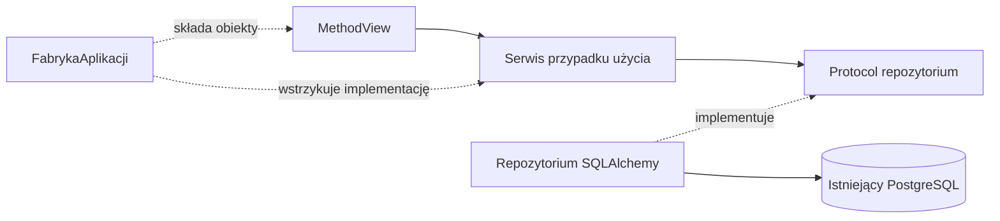

# Architektura i decyzje

## Ustalone

Flask będzie obsługiwał stronę i administrację. Nowa aplikacja powstaje w `handball_datascience`. Starszy serwis w katalogu nadrzędnym nie jest szkieletem nowej aplikacji.

Inspekcja 2026-09-12 potwierdziła PostgreSQL 15.1, bazę `zprp` na `localhost:5432`, użytkownika `postgres` oraz schematy `public` i `logs`. [Dokumentacja rzeczywistej bazy](database/README.md) jest punktem odniesienia dla zapytań. [Archiwalny plik schema_postgres.sql](database/schema_postgres_archiwalny.sql) (kopia wcześniejszego projektu bazy z katalogu nadrzędnego, stan 2026-09-10) jest wcześniejszym projektem i różni się od bazy. Nie wykonuj go w celu nawiązania połączenia.

Decyzja użytkownika z 2026-09-12: AI nie zmienia bazy samodzielnie. Jakikolwiek zapis, zmiana struktury lub administracja bazą wymagają wyraźnej prośby o daną zmianę. Sama implementacja Flaska nie upoważnia do migracji ani zapisu. Do inspekcji używamy transakcji tylko do odczytu, bez zmiany globalnej konfiguracji PostgreSQL.

## Przyjęty podział obiektowy

Decyzja z 2026-09-12: cały nowy kod aplikacyjny powstaje obiektowo i zgodnie z SOLID. Własne identyfikatory piszemy po polsku bez znaków diakrytycznych, spójnie z istniejącymi nazwami tabel i kolumn; zachowujemy oryginalne API bibliotek. Przyjęty stos oraz uzasadnienie: [TECH_STACK](TECH_STACK.md). Wymagania implementacji: [CODING_STANDARDS](CODING_STANDARDS.md).

- FabrykaAplikacji i Ustawienia składają aplikację oraz konfigurację. Cienki adapter create_app() obsługuje integrację z narzędziami Flaska.
- Klasy MethodView w Blueprints obsługują HTTP; szablony Jinja2 odpowiadają za prezentację.
- Klasy serwisów realizują przypadki użycia i logikę meczową.
- Kontrakty Protocol oddzielają serwisy od klas repozytoriów SQLAlchemy. Zależności przekazujemy przez konstruktor.
- Typowane modele SQLAlchemy 2.0 mapują istniejące tabele, a obiekty dataclass przenoszą filtry i wyniki.
- Flask-SQLAlchemy zarządza integracją silnika i sesji; sterownikiem PostgreSQL jest psycopg 3.
- Późniejszy eksporter będzie klasą korzystającą z tej samej logiki przypadków użycia.

Przepływ zależności:

To przyjęty projekt architektury; katalogi kodu powstaną dopiero wraz z pierwszą implementacją. Twórz klasy potrzebne konkretnej funkcji, bez pustych warstw i ogólnych repozytoriów CRUD na zapas.

Projekt modułów: [DIRECTORY_STRUCTURE](DIRECTORY_STRUCTURE.md). Diagramy klas, składania zależności i obsługi żądania: [UML](UML.md). Pakiet aplikacji będzie nazywał się pilka_reczna i znajdzie się w src.

## Decyzje otwarte

| Temat | Kiedy rozstrzygnąć |
| --- | --- |
| Dokładne wersje poprawek i konfiguracja narzędzi | Przy szkielecie: rozwiązanie zależności uv na Pythonie 3.13, zapis uv.lock i wspólne sprawdzenie |
| Integracja połączenia z Flaskiem | Parametry i schemat są rozpoznane; do przygotowania konfiguracja aplikacji bez sekretów w MD |
| Źródło kont, role i operacje administracyjne | Przed implementacją panelu; biblioteką sesji użytkownika będzie Flask-Login |
| Własne tabele aplikacji i migracje | Gdy pojawi się potrzeba trwałego zapisu |
| Format eksportu i hosting | Przy rozpoczęciu etapu publicznego serwisu |

## Warunki implementacji

Start aplikacji nie może importować danych, tworzyć tabel ani uruchamiać migracji w istniejącej bazie. Repozytoria odczytu korzystają z transakcji READ ONLY; sesji nie współdzielimy między żądaniami. Parametry zapytań muszą być przekazywane przez mechanizm sterownika/ORM; sortowanie wybierane z dopuszczonych pól. Zapytania listujące powinny mieć limit i stabilny porządek.

Przed udostępnieniem administracji wymagane są uwierzytelnienie, kontrola uprawnień oraz ochrona formularzy zmieniających stan. Pola pochodzące ze źródeł danych wymagają bezpiecznego renderowania. Eksport publiczny powinien mieć jawny zestaw pól, zamiast kopiować całe rekordy bazy.

Istotną rozstrzygniętą decyzję zapisuj tutaj z datą, powodem i skutkami. Osobny ADR dodawaj dopiero, gdy uzasadnienie jest zbyt obszerne dla tego dokumentu.
