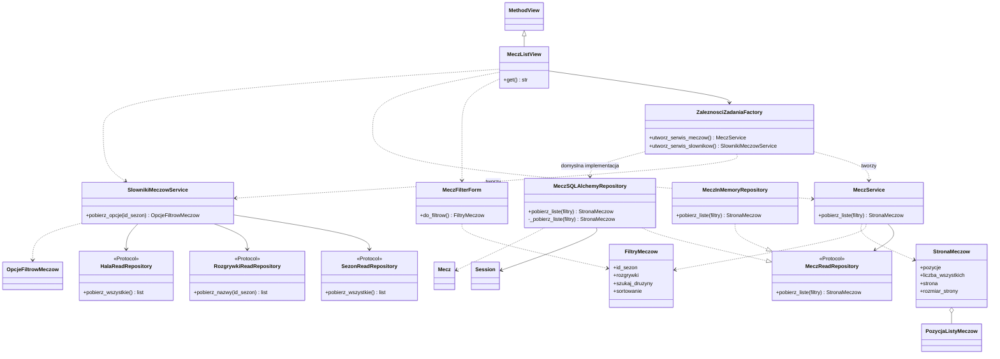

# Handball DataScience — dokumentacja architektury

## Cel dokumentu

Ten dokument wyjaśnia krok po kroku, jak działa aplikacja z tego repozytorium: gdzie zaczyna się żądanie, kto składa obiekty, kto pobiera dane i kto tworzy stronę. Punktem odniesienia jest rzeczywisty kod odczytany 2026-09-14, po zmianie nazw pakietu, katalogów i klas.

Działa strona startowa administracji i lista meczów. Szczegóły meczu, logowanie, większość pozycji menu i eksport pozostają planowane. Głównym przykładem jest **wyświetlenie listy meczów z filtrami**. Dokument nie przedstawia planowanych klas z wcześniejszego UML jako istniejącej implementacji.

Wersja HTML ma tę samą treść co ten MD. Opisy plików są względne wobec katalogu projektu; klikalne odnośniki prowadzą do źródeł. Zasady projektowania znajdują się osobno w [ARCHITECTURE](ARCHITECTURE.md), a szczegółowy stan prac w [STATUS](STATUS.md).

---

## 1. Główna struktura projektu

```text
handball_datascience/
├── run.bat                                  ← Przygotowuje środowisko i uruchamia Flaska.
├── pyproject.toml                           ← Pakiet, zależności i narzędzia jakości.
├── uv.lock                                  ← Konkretne wersje zależności.
├── src/
│   └── handball/                            ← Importowany pakiet aplikacji.
│       ├── __init__.py                      ← create_app(): wejście dla Flaska.
│       ├── app_factory.py                   ← Składa i konfiguruje aplikację.
│       ├── settings.py                      ← Ustawienia i adres połączenia.
│       ├── extensions.py                    ← Wspólna integracja Flask-SQLAlchemy.
│       ├── request_dependencies.py          ← Składa serwisy i repozytoria żądania.
│       ├── domain/                          ← Filtry, dane wyniku i błędy domenowe.
│       │   ├── matches.py                   ← FiltryMeczow, StronaMeczow, zakres daty.
│       │   ├── options.py                   ← OpcjaWyboru do list rozwijanych.
│       │   └── errors.py                    ← Brak meczu i błąd odczytu.
│       ├── contracts/                       ← Umowy odczytu jako Protocol.
│       ├── services/                        ← Przypadki użycia bez Flask request i SQL.
│       │   ├── match_service.py             ← Pobranie listy meczów.
│       │   └── match_dictionary_service.py  ← Opcje sezonów, rozgrywek i hal.
│       ├── infrastructure/
│       │   ├── database/
│       │   │   ├── connection.py            ← Konfiguracja połączenia READ ONLY.
│       │   │   └── models/                  ← Mapowanie istniejących tabel.
│       │   └── repositories/                ← Zapytania SQLAlchemy i wynik domenowy.
│       └── interface/
│           ├── registration.py              ← Rejestruje Blueprint administracji.
│           ├── navigation.py                ← Struktura menu i context processor.
│           ├── errors.py                    ← Tłumaczy błędy domenowe na HTTP.
│           ├── admin/
│           │   ├── __init__.py              ← Adresy stron i podłączenie MethodView.
│           │   ├── views/                   ← StartView i MeczListView.
│           │   └── forms/                   ← MeczFilterForm: dane wejściowe GET.
│           ├── templates/                   ← HTML/Jinja2 i MD przy każdym szablonie.
│           └── static/                      ← CSS i JS administracji.
├── tests/
│   ├── unit/                                ← Logika, filtry i konfiguracja.
│   ├── interface/                           ← Odpowiedzi HTTP i zasoby.
│   ├── helpers/                             ← Repozytoria pamięciowe do testów.
│   └── integration/                         ← Testy repozytoriów zależne od bazy.
└── docs/                                    ← Dokumentacja projektu i rozpoznanej bazy.
```

`handball` jest nazwą pakietu Pythona, a Handball DataScience nazwą produktu. Pliki i katalogi są angielskie. Pojęcia domenowe, metody i zmienne pozostają polskie, np. `Mecz`, `FiltryMeczow`, `pobierz_liste()`. Role techniczne klas są angielskie: `MeczService`, `MeczSQLAlchemyRepository`.

Pełny wykaz plików: [DIRECTORY_STRUCTURE](DIRECTORY_STRUCTURE.md). Katalogi z samymi opisami MD w `templates/admin/` nie oznaczają, że odpowiadające im ekrany już działają.

---

## 2. Rysunek warstw projektu

```text
                         PRZEGLĄDARKA
                              |
                              | GET /administracja/mecze
                              v
+---------------------------------------------------------------+
| INTERFACE                                                     |
| Blueprint -> MeczListView -> MeczFilterForm                     |
| Odczyt HTTP, walidacja, renderowanie odpowiedzi.                |
+-------------------------------+-------------------------------+
                                |
                                | gotowe filtry / sezon
                                v
+---------------------------------------------------------------+
| SERVICES                                                      |
| MeczService                  SlownikiMeczowService              |
| Lista meczów                 Opcje do list rozwijanych          |
| Zależności opisane kontraktami, bez zapytań SQL w serwisie.      |
+-------------------------------+-------------------------------+
                                |
                                | wywołanie kontraktu repozytorium
                                v
+---------------------------------------------------------------+
| INFRASTRUCTURE                                                |
| MeczSQLAlchemyRepository + repozytoria słowników                |
| Modele ORM -> SQLAlchemy Session -> sterownik psycopg           |
+-------------------------------+-------------------------------+
                                |
                                | SELECT w transakcji READ ONLY
                                v
                         PostgreSQL / zprp
```

Kontrakty z `contracts/` opisują operacje, których serwis potrzebuje. Konkretne repozytoria je realizują. `domain/` dostarcza wspólny język danych wejściowych i wyników: filtrów, opcji i pozycji listy.

Powyższe strzałki pokazują **przebieg wywołania**. Zależności kodu mają dodatkową granicę: serwis importuje kontrakt, a nie klasę SQLAlchemy. Dzięki temu w teście można podstawić repozytorium pamięciowe.

```text
MeczService -------- zna umowę --------> MeczReadRepository
                                                ^
                                                | realizuje
                                  MeczSQLAlchemyRepository
```

`request_dependencies.py` jest miejscem, które zna oba światy i łączy konkretną implementację z serwisem.

---

## 3. Najprostszy rysunek warstw

```text
Adres z filtrami
      |
      v
MeczListView       ← rozumie HTTP i wybiera szablon
      |
      v
MeczService        ← udostępnia przypadek użycia
      |
      v
Repozytorium       ← rozumie zapytanie i strukturę bazy
      |
      v
StronaMeczow       ← zwykły wynik Pythona
      |
      v
Jinja2 -> HTML -> przeglądarka
```

Widok nie buduje SQL. Szablon nie otwiera sesji. Repozytorium zwraca przygotowane dane, więc wyświetlenie nazwy gospodarza w Jinja2 nie powinno uruchamiać kolejnego zapytania ORM.

---

## 4. Lista meczów — dokładniej: pliki i odpowiedzialności

Lista potrzebuje dwóch zestawów danych: opcji do filtrów oraz samych meczów. W obecnym widoku opcje są pobierane przed pełną walidacją formularza.

```text
interface/admin/views/match_views.py
MeczListView.get()
    |
    +--> SlownikiMeczowService.pobierz_opcje(id_sezon)
    |       +--> SezonReadRepository.pobierz_wszystkie()
    |       +--> RozgrywkiReadRepository.pobierz_nazwy(id_sezon)
    |       +--> HalaReadRepository.pobierz_wszystkie()
    |
    +--> MeczFilterForm(request.args)
    |       +--> ustawienie choices
    |       +--> validate()
    |       +--> do_filtrow() -> FiltryMeczow
    |
    +--> MeczService.pobierz_liste(filtry)
    |       +--> MeczReadRepository.pobierz_liste(filtry)
    |               +--> licznik wyników
    |               +--> strona wyników
    |
    +--> render_template("admin/matches/list.html", ...)
```

Główne wejście to `GET /administracja/mecze`. Parametry HTTP obejmują `id_sezon`, `rozgrywki`, `id_hala`, `druzyna`, `data_meczu`, `strona`, `rozmiar_strony` i `sortowanie`. Brak sezonu oznacza wszystkie sezony, bez przekierowania do najnowszego.

Wynik stanowi strona HTML z tabelą, filtrami i paginacją. Pusta lista nadal daje HTTP 200. Niepoprawne wejście daje 400, a błąd odczytu jest tłumaczony na 503.

---

## 5. Diagram klas UML — lista meczów



Pusty trójkąt z linią ciągłą oznacza dziedziczenie. Linia przerywana z trójkątem oznacza realizację kontraktu. `Protocol` jest strukturalny: repozytorium nie musi jawnie po nim dziedziczyć. Przerywana strzałka bez trójkąta pokazuje użycie, a romb przy `StronaMeczow` — zawieranie pozycji listy.

### Skąd pochodzą klasy z diagramu

| Klasa / kontrakt | Plik |
| --- | --- |
| `MeczListView` | [match_views.py](../src/handball/interface/admin/views/match_views.py) |
| `MeczFilterForm` | [match_filters.py](../src/handball/interface/admin/forms/match_filters.py) |
| `ZaleznosciZadaniaFactory` | [request_dependencies.py](../src/handball/request_dependencies.py) |
| `MeczService` | [match_service.py](../src/handball/services/match_service.py) |
| `MeczReadRepository` | [match_repository.py](../src/handball/contracts/match_repository.py) |
| `MeczSQLAlchemyRepository` | [match_repository.py](../src/handball/infrastructure/repositories/match_repository.py) |
| `MeczInMemoryRepository` | [match_repository.py](../tests/helpers/match_repository.py) |
| `SlownikiMeczowService` | [match_dictionary_service.py](../src/handball/services/match_dictionary_service.py) |
| `SezonReadRepository` | [season_repository.py](../src/handball/contracts/season_repository.py) |
| `RozgrywkiReadRepository` | [competition_repository.py](../src/handball/contracts/competition_repository.py) |
| `HalaReadRepository` | [venue_repository.py](../src/handball/contracts/venue_repository.py) |
| `FiltryMeczow`, `StronaMeczow`, `PozycjaListyMeczow`, `OpcjeFiltrowMeczow` | [matches.py](../src/handball/domain/matches.py) |
| `Mecz` | [matches.py](../src/handball/infrastructure/database/models/matches.py) |
| `MethodView`, `Session` | Klasy bibliotek Flask i SQLAlchemy, nie własne pliki projektu. |

Implementacje słowników to `SezonSQLAlchemyRepository`, `RozgrywkiSQLAlchemyRepository` i `HalaSQLAlchemyRepository` z `infrastructure/repositories/`. Mają osobne kontrakty, ponieważ lista sezonów i wyszukiwanie meczów to różne operacje.

---

## 6. Lista meczów — plik po pliku, funkcja po funkcji

### `interface/admin/views/match_views.py`

**Klasa:** `MeczListView`.

**Po co istnieje:** łączy świat HTTP z przypadkami użycia i szablonem. Konstruktor przechowuje fabrykę zależności. Dopiero `get()` tworzy potrzebne serwisy.

`get()` odczytuje wybrany sezon, pobiera opcje, buduje formularz, ustawia jego `choices` i sprawdza poprawność. Następnie tworzy `FiltryMeczow`, pobiera `StronaMeczow` i renderuje `admin/matches/list.html`.

Widok przekazuje do Jinja2 `strona`, `filtry`, `opcje`, `formularz` i `sekcja_aktywna`. Obsługuje błędy odczytu opcji niezależnie od błędów pobierania meczów. Ponieważ słowniki są odczytywane wcześniej, błędny formularz nie oznacza automatycznie braku zapytań do bazy.

### `interface/admin/forms/match_filters.py`

**Klasa:** `MeczFilterForm`, oparta na WTForms.

**Po co istnieje:** sprawdza i przekształca tekst z parametrów adresu. Listy sezonów, rozgrywek i hal dostają dopuszczalne opcje od widoku.

- `validate()` jest odziedziczoną metodą WTForms; sprawdza pola i listy wyboru.
- `do_filtrow()` zamienia puste wybory na `None`, identyfikatory na liczby, a datę na zakres.
- `_waliduj_czesciowa_date()` jest funkcją modułu, nie metodą klasy. Tłumaczy błąd parsera na komunikat walidacji formularza.

`druzyna` w adresie trafia do pola `szukaj_druzyny` w domenie. `data_meczu` trafia do `data_od` i `data_do`. Sortowanie pozostaje polem walidowanym, ale w HTML jest obsługiwane linkiem w nagłówku tabeli.

### `domain/matches.py`

**Obiekty:** `FiltryMeczow`, `PozycjaListyMeczow`, `StronaMeczow` i `OpcjeFiltrowMeczow`.

**Po co istnieje:** opisuje wejście i wynik niezależnie od Flaska oraz SQLAlchemy.

`zakres_z_czesciowej_daty(tekst)` przyjmuje rok, rok i miesiąc albo pełną datę. Zwraca początek i wyłączny koniec przedziału. Dla `2026-09` jest to od 1 września do 1 października, bez włączania października.

`FiltryMeczow.__post_init__()` pilnuje dodatniego numeru strony, rozmiaru strony 1–100 i sortowania `data` albo `-data`. Formularz odpowiada za interpretację HTTP, a ten obiekt za podstawowe warunki użycia filtrów także poza HTTP.

Klasy mają `frozen=True`. Nie oznacza to głębokiej niezmienności list zawartych w obiektach, np. `StronaMeczow.pozycje` nadal jest listą.

### `services/match_service.py`

**Klasa:** `MeczService`.

**Po co istnieje:** daje widokowi kontrakt przypadku użycia. Konstruktor przyjmuje `MeczReadRepository`.

`pobierz_liste(filtry)` obecnie deleguje bezpośrednio do repozytorium. Nie ma tu jeszcze rozbudowanych obliczeń statystycznych ani dodatkowej polityki biznesowej. Ta cienka warstwa pozwala rozbudować przypadek użycia bez przenoszenia SQL do widoku.

### `services/match_dictionary_service.py`

**Klasa:** `SlownikiMeczowService`.

**Po co istnieje:** zbiera opcje formularza z trzech wąskich kontraktów.

`pobierz_opcje(id_sezon)` pobiera wszystkie sezony i hale oraz nazwy rozgrywek, opcjonalnie ograniczone do sezonu. Składa wynik `OpcjeFiltrowMeczow`. Nie renderuje elementów `<select>` — tym zajmują się formularz i Jinja2.

### `contracts/match_repository.py` i kontrakty słowników

**Kontrakt:** `MeczReadRepository`.

**Po co istnieje:** opisuje metodę `pobierz_liste(filtry) -> StronaMeczow`, której potrzebuje serwis. Nie obejmuje zapisu, usuwania ani szczegółów meczu.

Słowniki mają osobne kontrakty: sezony i hale udostępniają `pobierz_wszystkie()`, a rozgrywki `pobierz_nazwy(id_sezon)`. Nazwy zwracane przez repozytorium rozgrywek są unikalne; użytkownik wybiera nazwę rozgrywek, nie osobny identyfikator dla każdego sezonu.

### `infrastructure/repositories/match_repository.py`

**Klasa:** `MeczSQLAlchemyRepository`.

**Po co istnieje:** zamyka wiedzę o tabelach, zapytaniach i przygotowaniu wyniku.

- `__init__(sesja)` dostaje sesję z zewnątrz; nie tworzy własnego połączenia.
- `pobierz_liste(filtry)` uruchamia odczyt i tłumaczy `SQLAlchemyError` na `BladOdczytuDanych`.
- `_pobierz_liste(filtry)` buduje złączenia, filtry, licznik, sortowanie i paginację, wykonuje zapytania oraz tworzy obiekty wyniku.
- Po refaktoryzacji 2026-09-19 wynik formatuje `MeczPresenter.przygotuj_liste()` w `interface/presenters/match_presenter.py`. Repozytorium zwraca typowane dane źródłowe; brak którejkolwiek części wyniku nadal daje `- : -`, a liczby np. `0 : 0`. Aktualny podział opisują DIRECTORY_STRUCTURE.md i UML.md.

Gospodarz i gość są dwoma aliasami `ZespolSezon`. Złączenie używa identyfikatora zespołu **i sezonu**, aby pokazać nazwę historyczną. Zespoły i hala są dołączane zewnętrznie, więc ich brak nie musi usuwać meczu z wyniku.

Wyszukiwanie drużyny znajduje identyfikatory zespołów przez `ILIKE` na nazwach w `zespoly_sezony`, a następnie filtruje gospodarza lub gościa po tych identyfikatorach. Jedna historyczna nazwa może zatem znaleźć mecze z innych sezonów. Krótka fraza może dopasować kilka różnych zespołów.

Repozytorium wykonuje osobne zapytanie liczące i osobne zapytanie strony. Sortuje po dacie, a przy remisie po `Mecz.id`; używa `LIMIT` i `OFFSET`. Nie należy z tego wyciągać wniosku, że licznik i strona zawsze widzą identyczną migawkę przy równoległych zmianach — kod nie ustawia tu osobno poziomu izolacji.

### `request_dependencies.py`

**Klasa:** `ZaleznosciZadaniaFactory`.

**Po co istnieje:** wybiera konkretne repozytoria i przekazuje je serwisom. Konstruktor przyjmuje opcjonalne funkcje tworzące repozytoria. Domyślne funkcje korzystają z `baza_danych.session`.

`utworz_serwis_meczow()` tworzy repozytorium meczów i `MeczService`. `utworz_serwis_slownikow()` tworzy trzy repozytoria słowników i `SlownikiMeczowService`. To tutaj test może podstawić implementacje pamięciowe.

### `interface/templates/admin/matches/list.html`

**Po co istnieje:** pokazuje gotowy wynik jako tabelę i formularz. Dziedziczy [base.html](../src/handball/interface/templates/base.html) i dołącza fragment paginacji.

Nie zawiera klas Pythona. Korzysta z obiektów przekazanych przez widok. Nagłówek „Data” przełącza sortowanie i resetuje numer strony; paginacja zachowuje pozostałe parametry. Szczegółowy kontrakt: [list.md](../src/handball/interface/templates/admin/matches/list.md).

### `interface/navigation.py` i `interface/errors.py`

`PozycjaMenu` opisuje pojedynczą pozycję nawigacji. `zarejestruj_kontekst_nawigacji()` rejestruje funkcję wstrzykującą menu do szablonów. Pozycje z `punkt_koncowy=None` są widoczne, ale nie prowadzą do działającego widoku.

`obsluz_blad_domeny()` tłumaczy brak meczu na 404, a `BladOdczytuDanych` na 503. Własne szablony błędów są jeszcze planowane; obecnie używana jest standardowa odpowiedź Flaska.

---

## 7. Co robi każda warstwa

| Warstwa | Co rozumie | Przykład w tym projekcie |
| --- | --- | --- |
| Widok | HTTP, formularz, wybór odpowiedzi | `MeczListView.get()` |
| Formularz | Tekst parametrów i dopuszczalne wybory | `MeczFilterForm.do_filtrow()` |
| Serwis | Operację potrzebną odbiorcy | `MeczService.pobierz_liste()` |
| Kontrakt | Metody wymagane od dostępu do danych | `MeczReadRepository` |
| Repozytorium | SQL, złączenia, paginację i projekcję | `MeczSQLAlchemyRepository` |
| Model ORM | Tabelę i kolumny istniejącej bazy | `Mecz`, `ZespolSezon` |
| Obiekt domenowy | Dane potrzebne logice i prezentacji | `FiltryMeczow`, `StronaMeczow` |
| Szablon | Sposób pokazania danych | `admin/matches/list.html` |
| Fabryka zależności | Konkretne implementacje i konstruktory | `ZaleznosciZadaniaFactory` |

Osobny `Mapper` nie istnieje. Konwersja wierszy ORM do `PozycjaListyMeczow` odbywa się w repozytorium. Nie ma też klas Pydantic opisujących JSON API listy: wejściem jest formularz GET, a wyjściem HTML.

---

## 8. Przepływ konkretnego procesu

Przykład ilustracyjny — nie jest zapytaniem wykonanym teraz na bazie:

```text
GET /administracja/mecze?druzyna=Kielce&data_meczu=2026-09&sortowanie=-data
```

```text
1. Flask dopasowuje adres do administracja.lista_meczow.
2. Tworzy MeczListView z przekazaną fabryką zależności.
3. Widok pobiera opcje sezonów, rozgrywek i hal.
4. Formularz sprawdza tekst i dopuszczalne wartości.
5. do_filtrow() tworzy FiltryMeczow:
       szukaj_druzyny = "Kielce"
       data_od = 2026-09-01
       data_do = 2026-10-01
       sortowanie = "-data"
       strona = 1, rozmiar_strony = 20
6. MeczService przekazuje filtry do repozytorium.
7. Repozytorium ogranicza mecze, liczy wynik i pobiera stronę.
8. Wiersze są zamieniane na PozycjaListyMeczow i StronaMeczow.
9. Jinja2 renderuje tabelę, opcje filtrów i paginację.
10. Flask zwraca HTML; zamknięcie kontekstu sprząta sesję.
```

Błędy mają różne znaczenie:

```text
Niepoprawna data albo opcja formularza -> 400
Brak pasujących meczów                 -> 200, komunikat pustej listy
Awaria odczytu opcji albo meczów        -> 503
Brak konkretnego meczu                 -> błąd domenowy z mapowaniem 404
                                         (szczegóły meczu jeszcze nie istnieją)
```

W zwykłym przebiegu listy powstają trzy odczyty słowników oraz dwa odczyty repozytorium meczów. Dopasowanie nazwy zespołu jest podzapytaniem wewnątrz zapytań meczów, a nie osobnym pobraniem identyfikatorów do Pythona.

---

## 9. Jak obiekty są tworzone

```text
run.bat / flask --app handball
    |
    v
create_app()
    +--> Ustawienia.z_srodowiska()
    +--> AplikacjaFactory(ustawienia).utworz()
             +--> Flask("handball", ...)
             +--> PolaczenieConfigurator.skonfiguruj_odczyt()
             +--> baza_danych.init_app()
             +--> zarejestruj_kontekst_nawigacji()
             +--> WidokiRegistrar.zarejestruj()
                      +--> utworz_blueprint_administracji()
                      +--> MeczListView.as_view(..., fabryka_zaleznosci)
```

[create_app()](../src/handball/__init__.py) jest małym adapterem wymaganym przez narzędzia Flaska. [AplikacjaFactory](../src/handball/app_factory.py) składa aplikację. [WidokiRegistrar](../src/handball/interface/registration.py) rejestruje Blueprint, a funkcja [utworz_blueprint_administracji()](../src/handball/interface/admin/__init__.py) przypisuje adresy do klas widoków.

Framework tworzy instancję `MeczListView` dla żądania. Obecny konstruktor widoku przechowuje fabrykę; serwisy powstają podczas `get()`, nie przy starcie aplikacji. Fabryka przechowuje funkcje tworzące repozytoria, a domyślne funkcje odwołują się do sesji bieżącego kontekstu.

```text
Obiekty aplikacji: konfiguracja, integracja ORM, rejestracja, fabryka
                                   |
                                   v
Kontekst żądania: widok -> serwisy -> repozytoria -> sesja
                                   |
                                   v
Wynik odłączony od ORM: StronaMeczow -> Jinja2
```

Nie ma zewnętrznego kontenera DI. Wstrzykiwanie zależności oznacza tu zwykłe konstruktory i funkcje tworzące obiekty. W testach te funkcje zwracają repozytoria pamięciowe zamiast repozytoriów SQLAlchemy.

---

## 10. Transakcje i skutki uboczne

[PolaczenieConfigurator](../src/handball/infrastructure/database/connection.py) ustawia adres SQLAlchemy, `pool_pre_ping=True` i `execution_options={"postgresql_readonly": True}`. Integrację z Flaskiem udostępnia [extensions.py](../src/handball/extensions.py).

```text
Utworzenie aplikacji
    -> konfiguracja silnika, bez pobierania danych

Żądanie listy
    -> pierwsze użycie sesji
    -> transakcja READ ONLY
    -> odczyty słowników, licznik i strona meczów
    -> utworzenie obiektów wyniku
    -> odpowiedź HTML
    -> usunięcie sesji przy zamknięciu kontekstu
    -> rollback otwartej transakcji i zwrot połączenia do puli
```

Repozytorium nie zatwierdza transakcji i nie zmienia rekordów. Nie ma osobnej klasy `UnitOfWork` ani ścieżki zapisu. Sprzątanie sesji należy do integracji Flask-SQLAlchemy, nie do `MeczService`.

Baza ma istniejące schematy `public` i `logs`; modele aplikacji mapują wybrane tabele potrzebne liście. Dokumentacja bazy opisuje również funkcje wykonujące zapis. Samo użycie `SELECT` nie oznacza więc, że dowolna funkcja bazy jest tylko odczytem. Ten dokument powstał bez wykonywania SQL.

Konfigurację opisujemy nazwami zmiennych, np. `BAZA_HOST`, `BAZA_NAZWA`, `BAZA_HASLO`, bez wartości sekretów. Lokalny plik ustawień może różnić się od wersji zapisanej w Git; jego treść nie jest kopiowana do dokumentacji.

---

## 11. Dane — obiekty domenowe, modele i wejście/wyjście

```text
Parametry HTTP: tekst
    |
    v
MeczFilterForm                   ← walidacja i konwersja wejścia
    |
    v
FiltryMeczow                     ← kryteria niezależne od HTTP
    |
    v
SQLAlchemy: Mecz + złączenia      ← mapowanie istniejących tabel
    |
    v
PozycjaListyMeczow               ← dane jednego wiersza strony
    |
    v
StronaMeczow                    ← pozycje, licznik i paginacja
    |
    v
Jinja2                          ← gotowy HTML
```

### Model ORM

`Mecz` z `infrastructure/database/models/matches.py` odpowiada tabeli `public.mecze`. `ZespolSezon` opisuje sezonową migawkę zespołu, a `Sezon`, `Rozgrywki` i `Hala` dostarczają danych użytych w złączeniach.

Modele mają prawdziwe nazwy tabel, kolumn i schematów. Zmiana nazwy pliku na `matches.py` nie zmieniła tabeli `mecze` na `matches`.

### Dane wyniku

`PozycjaListyMeczow` zawiera `id_mecz`, termin, sezon, rozgrywki, gospodarza, gościa, wynik i halę. Są to pola do prezentacji; obiekt nie zna sesji SQLAlchemy. `StronaMeczow` dokłada listę pozycji, liczbę wszystkich wyników, numer strony i rozmiar strony.

Wynik meczu jest obecnie napisem z pól `wynik_gosp_full` i `wynik_gosc_full`. Brak wyniku jest odróżniony od `0 : 0`. Interpretacja dodatkowych wariantów wyniku i pola `zamiana` wymaga dalszych ustaleń przed szczegółami meczu.

### Dane słowników

`OpcjaWyboru` z [options.py](../src/handball/domain/options.py) zawiera wartość i etykietę. Używają go sezony i hale. Rozgrywki są listą unikalnych nazw, ponieważ ta sama nazwa może wystąpić w wielu sezonach.

### Gdy zmieni się interfejs albo baza

Inny interfejs może wywołać `MeczService` z obiektem `FiltryMeczow`. Nie musi kopiować zapytań z widoku. Baza z angielskimi nazwami wymagałaby zmiany mapowania i zapytań, ale nie wymusza angielskich nazw obiektów domenowych. Zmiany znaczenia danych nadal trzeba osobno przeanalizować i przetestować.

---

## 12. Testy — co sprawdzają

```text
unit/          -> filtry, parser daty, delegację serwisu, konfigurację
interface/     -> odpowiedź HTTP, renderowanie, sortowanie i zasoby
helpers/       -> pamięciowe zamienniki kontraktów repozytoriów
integration/   -> zachowanie zapytań wobec PostgreSQL
```

### Testy jednostkowe

[test_match_filters.py](../tests/unit/test_match_filters.py) sprawdza zakres roku, miesiąca i dnia, przejście grudnia do kolejnego roku, niepoprawne daty oraz granice paginacji i sortowania.

[test_match_service.py](../tests/unit/test_match_service.py) sprawdza delegację do repozytorium i pusty wynik. [test_app_factory.py](../tests/unit/test_app_factory.py) oraz [test_settings.py](../tests/unit/test_settings.py) dotyczą konfiguracji i budowania aplikacji.

### Testy interfejsu

[test_matches.py](../tests/interface/test_matches.py) podstawia repozytoria pamięciowe przez fabrykę zależności. Sprawdza listę bez filtrów, błędne wejście, częściową datę, renderowanie danych, pusty wynik i link sortowania w nagłówku.

[test_start.py](../tests/interface/test_start.py) sprawdza stronę startową oraz dostępność CSS i JS. Te testy nie dowodzą poprawności SQL ani dopasowania historycznych nazw zespołów w prawdziwej bazie.

### Testy integracyjne

[test_match_repository.py](../tests/integration/test_match_repository.py) sprawdza odczyt repozytorium, puste wyniki, wyszukiwanie historycznych nazw i unikalność nazw rozgrywek. Obecne testy zależą od zmiennej `BAZA_HASLO` oraz danych w bazie; bez niej są pomijane.

Jeden test próbuje utworzyć tabelę tymczasową, aby potwierdzić blokadę zapisu. Zgodnie z zasadami projektu nie uruchamiamy go automatycznie na bazie użytkownika. Do sprawdzania zapisów potrzebne jest osobno udostępnione, odizolowane środowisko.

### Zakres potwierdzenia

W poprzedniej weryfikacji migracji nazw przeszło 37 testów jednostkowych i interfejsu; zapisano też pozytywny wynik Ruff i mypy w STATUS. To wyniki wcześniejszego zadania. Przy przygotowaniu tego dokumentu nie uruchamiano aplikacji ani testów bazy.

Nie ma katalogu `tests/architecture/`. Zasady kierunku zależności są opisane w dokumentacji, ale nie należy przypisywać projektowi nieistniejącego automatycznego zestawu testów architektury.

---

## 13. Co pozostaje do zbudowania

Następny etap to szczegóły meczu. `MeczDetailView` nie istnieje jeszcze w kodzie, a [detail.md](../src/handball/interface/templates/admin/matches/detail.md) opisuje planowany szablon.

Do wykonania pozostają także dostęp administratora, pozostałe ekrany menu, własne strony błędów i eksport. Wygląd menu nie oznacza gotowości tych funkcji. Ten przewodnik należy rozszerzać, gdy pojawią się ich rzeczywiste implementacje.
