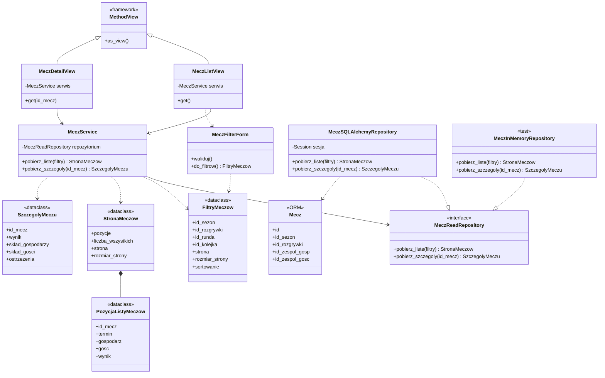
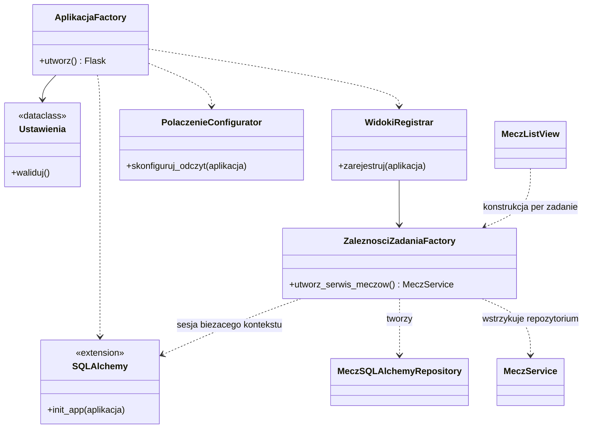
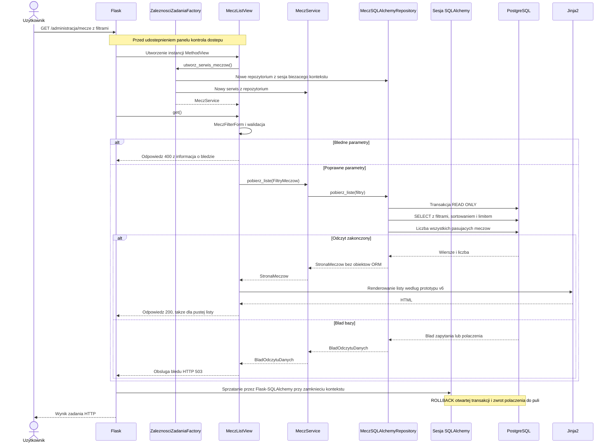

# UML — projekt obiektów i działania aplikacji

Status: projekt, nie dokumentacja istniejącego kodu. Diagramy zapisano w Mermaid, dzięki czemu pozostają edytowalną częścią MD. Pierwszy zakres to odczyt listy meczów i później szczegóły. [Projekt katalogów](DIRECTORY_STRUCTURE.md) przypisuje klasy do plików. [Relacje bazy](database/RELATIONSHIPS.md) opisują osobno istniejący model danych.

## Konwencja nazw a diagramy

Diagramy i tabela modułów używają nazw wdrożonych 2026-09-14 zgodnie z [CODING_STANDARDS](CODING_STANDARDS.md#język-i-nazewnictwo). Modele i metody pozostają polskie; klasy techniczne mają angielskie role, np. `MeczService`, `MeczReadRepository` i `MeczListView`. Elementy szczegółów meczu pozostają planowane.

## 1. Diagram klas pierwszego zakresu

Strzałka z pustym trójkątem oznacza dziedziczenie, przerywana z trójkątem realizację kontraktu, a zwykła przerywana zależność. Protocol jest kontraktem strukturalnym: implementacja nie musi po nim dziedziczyć. Metody pokazują projekt odpowiedzialności; szczegóły typów parametrów dopracujemy w implementacji.

Metody szczegółów i MeczDetailView dochodzą w etapie 5. Jeśli różni odbiorcy potrzebują odrębnych kontraktów listy i szczegółów, rozdzielimy Protocol zgodnie z ISP; nie dodajemy operacji zapisu do kontraktu odczytu.

Filtry mają jawne reguły: identyfikatory są opcjonalne według funkcji, strona i rozmiar dodatnie, rozmiar ograniczony, sortowanie z listy dozwolonej. Kolejność wyników musi być stabilna, z id jako rozstrzygnięciem remisów sortowania. Brak meczu oznacza NieZnalezionoMeczu, brak wyników listy pustą StronaMeczow, a awaria zapytania BladOdczytuDanych. Implementacja pamięciowa zachowuje tę samą semantykę.

Pole wynik w obiekcie widoku jest planowaną prezentacją danych, nie nową kolumną bazy. Nazwy i kształt obiektów wyniku zostaną doprecyzowane po ustaleniu interpretacji zamiana, wariantów wyniku i braków. Modele ORM nie wychodzą z repozytorium do Jinja2.

## 2. Składanie aplikacji i zależności

create_app() deleguje do AplikacjaFactory.utworz(). Fabryka ładuje Ustawienia, konfiguruje szablony i zasoby, inicjalizuje rozszerzenia i rejestruje Blueprints. Nie wykonuje importu, tworzenia tabel ani zapisu. Konfiguracja połączenia nie oznacza pobierania wszystkich danych przy starcie.

WidokiRegistrar przekazuje bezstanową ZaleznosciZadaniaFactory jako argument as_view(). Flask tworzy instancję MethodView dla każdego żądania. Jej konstruktor prosi fabrykę o serwis. Fabryka pobiera sesję bieżącego kontekstu, przekazuje ją do nowej instancji repozytorium i przekazuje repozytorium do nowego serwisu. Widok zachowuje gotowy serwis. Logika nie pobiera zależności z current_app ani db.session.

ZaleznosciZadaniaFactory jest miejscem składania obiektów, nie globalnym magazynem serwisów. Może istnieć przez czas życia aplikacji, ale nie przechowuje sesji ani obiektów żądania. Instancje repozytorium, serwisu i widoku są związane z jednym żądaniem. W testach można podać fabrykę zwracającą serwis z repozytorium pamięciowym.

## 3. Sekwencja wyświetlenia listy meczów

Projektowana trasa: GET /administracja/mecze, z parametrami id_sezon, id_rozgrywki, id_runda, id_kolejka, strona, rozmiar_strony i sortowanie. Szczegóły: GET /administracja/mecze/<id_mecz>. Są to planowane adresy, jeszcze niezarejestrowane.

Sesję sprząta integracja Flask-SQLAlchemy, a nie metoda repozytorium. Diagram pokazuje logiczny przepływ zapytań repozytorium do bazy; technicznie wykonuje je sesja SQLAlchemy przez sterownik. Przy błędzie walidacji transakcja nie musi zostać otwarta. Każde rzeczywiste użycie połączenia, również ponowne użycie z puli, musi zachować READ ONLY. Nie wykonujemy COMMIT ani zapisu przy odczycie.

Na etapie implementacji dobierz spójną migawkę dla zapytania strony i licznika, jeżeli mają przedstawiać dokładnie ten sam stan przy równoległych aktualizacjach danych. Zapytania mogą zostać połączone lub zoptymalizowane bez zmiany kontraktu wyniku. Diagram nie jest wymogiem wykonania dokładnie dwóch SELECT.

Dla szczegółów przebieg jest analogiczny: repozytorium przygotowuje dane meczu i powiązań bez mnożenia agregacji przez JOIN, a NieZnalezionoMeczu jest mapowane na 404. Renderowanie nie uruchamia lazy loading.

## 4. Etapy dostępu i późniejsza rozbudowa

Podczas lokalnej budowy wyglądu i odczytu nie udostępniamy panelu innym użytkownikom. Przed udostępnieniem etap logowania dodaje kontrolę sesji i uprawnień przed wykonaniem chronionego przypadku użycia. Nie projektujemy jeszcze tabel kont ani zapisu zmian administracyjnych.

Ekrany zespołów, zawodników i diagnostyki będą używały tego samego kierunku zależności, z kontraktami dopasowanymi do ich potrzeb. Eksporter będzie klientem serwisów, a nie kopią zapytań z widoków. Rozbudowa nie oznacza tworzenia pustych klas ani dodatkowych tabel.

## 5. Powiązanie z plikami i SOLID

| Obiekt | Planowany moduł w src/handball/ | Odpowiedzialność |
| --- | --- | --- |
| AplikacjaFactory | app_factory.py | Konfiguracja i złożenie aplikacji. |
| Ustawienia | settings.py | Walidowana konfiguracja. |
| ZaleznosciZadaniaFactory | request_dependencies.py | Złożenie repozytorium i serwisu dla żądania. |
| PolaczenieConfigurator | infrastructure/database/connection.py | Konfiguracja odczytu i integracji cyklu życia połączeń. |
| WidokiRegistrar | interface/registration.py | Rejestracja adresów i klas widoków. |
| MeczListView, MeczDetailView | interface/admin/views/match_views.py | Adaptacja HTTP. |
| MeczFilterForm | interface/admin/forms/match_filters.py | Walidacja parametrów i utworzenie FiltryMeczow. |
| MeczService | services/match_service.py | Przypadki użycia niezależne od frameworka. |
| MeczReadRepository | contracts/match_repository.py | Kontrakt odczytu bez metod zapisu. |
| MeczSQLAlchemyRepository | infrastructure/repositories/match_repository.py | Zapytania i budowanie typowanego wyniku. |
| FiltryMeczow, StronaMeczow, PozycjaListyMeczow, SzczegolyMeczu | domain/matches.py | Typowane dane wejścia i wyjścia. |
| NieZnalezionoMeczu, BladOdczytuDanych | domain/errors.py | Błędy niezależne od HTTP i sterownika. |
| Mecz | infrastructure/database/models/matches.py | Mapowanie public.mecze. |

SRP oddziela HTTP, przypadek użycia i zapytania. DIP realizuje zależność serwisu od Protocol. ISP ogranicza kontrakt do odczytu. LSP wymaga tej samej semantyki błędów i wyników w obu repozytoriach. OCP pozwala dodać inną implementację repozytorium bez zmiany MeczService. Szczegółowe wymagania pozostają w [CODING_STANDARDS](CODING_STANDARDS.md).
