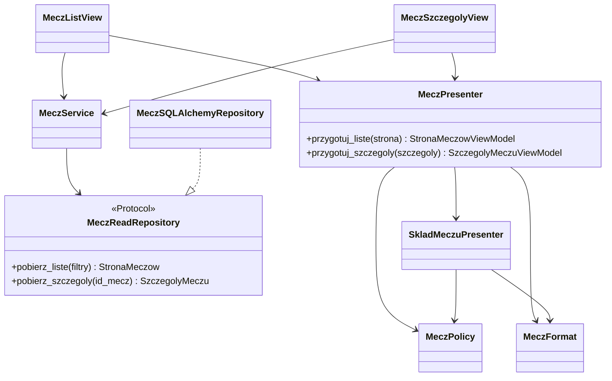
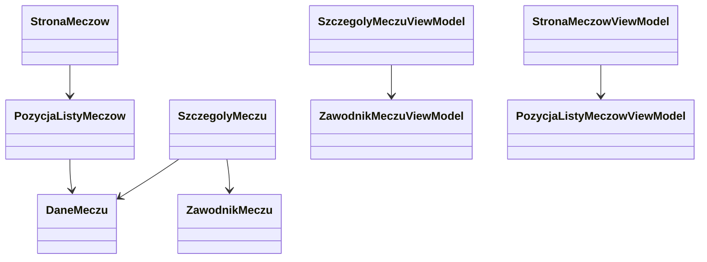
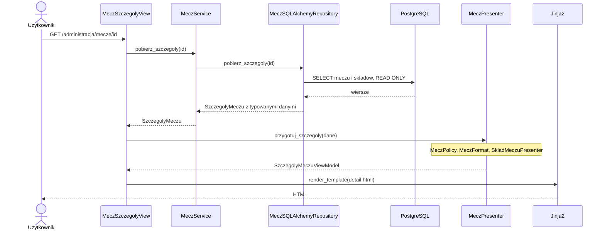
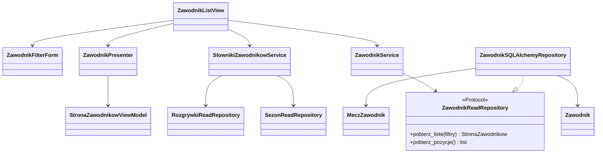
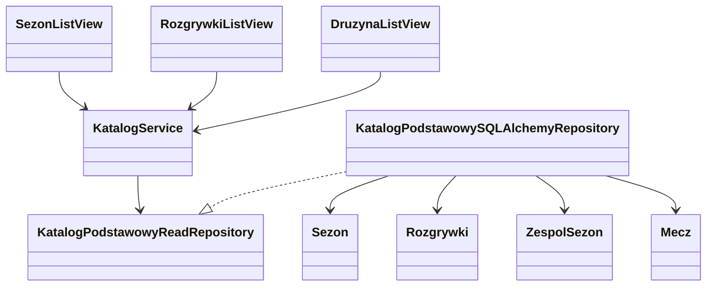
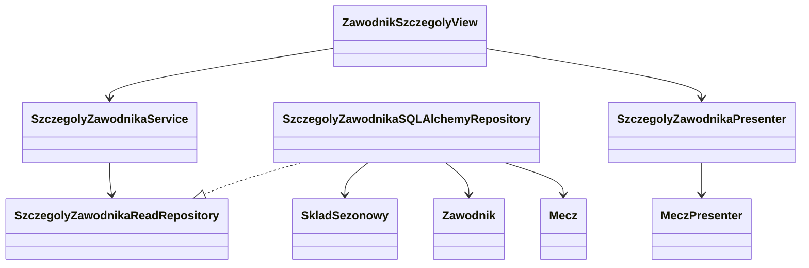

# UML rzeczywistych warstw aplikacji

Stan po refaktoryzacji 2026-09-19. Diagramy opisują istniejący kod. Planowane logowanie i pozostałe widoki odczytu nie są tu przedstawiane jako gotowe. Moduły i odpowiedzialności: [DIRECTORY_STRUCTURE](DIRECTORY_STRUCTURE.md).

## Zależności odczytu i prezentacji

Repozytorium mapuje ORM na dane domenowe i nie przygotowuje etykiet, dat w formacie tekstowym ani kolorów. Serwis deleguje odczyt do kontraktu. Presenter korzysta z reguł domenowych, ale domena i serwis nie znają presentera.

## Dane i modele widoku

Liczby i daty pozostają typowane w domenie; `None` zachowuje brak informacji. Modele widoku w `interface/view_models/matches.py` zawierają gotowe teksty i pola wyróżnień. Są odrębnymi dataclass, nie dziedziczą po modelach ORM i nie wymagają aktywnej sesji.

## Składanie zależności

`create_app()` deleguje do `AplikacjaFactory`. Fabryka ustawia Flask, SQLAlchemy, konfigurację odczytu, nawigację oraz rejestratory. `WidokiRegistrar` przekazuje `ZaleznosciZadaniaFactory` do klas MethodView.

`ZaleznosciZadaniaFactory` tworzy repozytorium z sesją bieżącego żądania oraz serwis. Jej `utworz_presenter_meczow()` składa `MeczPolicy`, `MeczFormat`, `SkladMeczuPresenter` i `MeczPresenter`. Widoki nie tworzą tych zależności wewnątrz `get()`.

`ImportRegistrar` składa istniejącą ścieżkę importu osobno. Rejestracja widoku nie oznacza uruchomienia importu. Żadna z nowych klas prezentacji nie ma dostępu do sesji ORM.

## Żądanie szczegółów

Nieznany mecz daje 404; błąd repozytorium daje 503. Sesja odczytu jest sprzątana przez integrację Flask-SQLAlchemy z ROLLBACK, bez zatwierdzania zapisów.

Lista działa analogicznie z `MeczFilterForm`, słownikami, `FiltryMeczow`, `StronaMeczow` i `StronaMeczowViewModel`. Jej parametry to `id_sezon`, `rozgrywki`, `runda`, `kolejka`, `id_hala`, `druzyna`, `data_meczu`, `sortowanie`, `strona` i `rozmiar_strony`.

## Przeglądarka

`matches.js` obsługuje pamięć filtrów, widoczność kolumn, modal szczegółów i zakładki. Modal pobiera tę samą trasę szczegółów i wyciąga `[data-match-detail]`; pełna karta oraz podgląd korzystają z jednego presentera i szablonu. Szczegóły kontraktów: [list.md](../src/handball/interface/templates/admin/matches/list.md), [detail.md](../src/handball/interface/templates/admin/matches/detail.md).

## Lista zawodników — 2026-09-20

Fabryka przekazuje repozytorium z sesją żądania. GET waliduje filtry, pobiera stronę domenową i prezentuje gotowe teksty. PostgreSQL wykonuje agregację po zawodniku z liczbą różnych meczów i kontrolą wielokrotnych stron. Repozytorium ogranicza paginację do ostatniej strony. Błędy danych wejściowych dają 400, odczytu 503; bez wyników widok zwraca 200.

## Karta hali

~~~mermaid
classDiagram
    HalaSzczegolyView --> SzczegolyHaliService
    SzczegolyHaliService --> SzczegolyHaliReadRepository
    SzczegolyHaliSQLAlchemyRepository ..|> SzczegolyHaliReadRepository
    SzczegolyHaliSQLAlchemyRepository --> Hala
    SzczegolyHaliSQLAlchemyRepository --> Mecz
    SzczegolyHaliSQLAlchemyRepository --> MeczZawodnik
    HalaSzczegolyView --> MeczService
    HalaSzczegolyView --> MeczPresenter
    HalaSzczegolyView --> SzczegolyHaliPresenter
~~~

Podsumowanie, zawodnicy i rankingi pochodzą z repozytorium szczegółów hali. Paginowane mecze przechodzą przez istniejący kontrakt meczów i presenter. Agregacje używają GROUP BY i COUNT DISTINCT, a nazwy drużyn strony zawodników pobiera jedno zapytanie zbiorcze.

## Podstawowe katalogi

Wspólny formularz przekazuje tylko typowane filtry katalogowe. Zapytania agregują liczniki przed paginacją; widoki nie znają SQLAlchemy ani sesji.

## Karta zawodnika

Repozytorium pobiera historię składów osobno od meczów, bez mnożenia wpisów. EXISTS wybiera różne mecze zawodnika; LIMIT/OFFSET dotyczy meczów, a dodatkowe zapytanie pobiera wszystkie jego wpisy z bieżącej strony. Modal pobiera ten sam HTML co pełna karta. Paginacja dostaje parametry z id_zawodnik i zakladka=mecze; JavaScript przechwytuje wyłącznie nawigację wewnątrz karty, pozostawiając linki do meczów.
