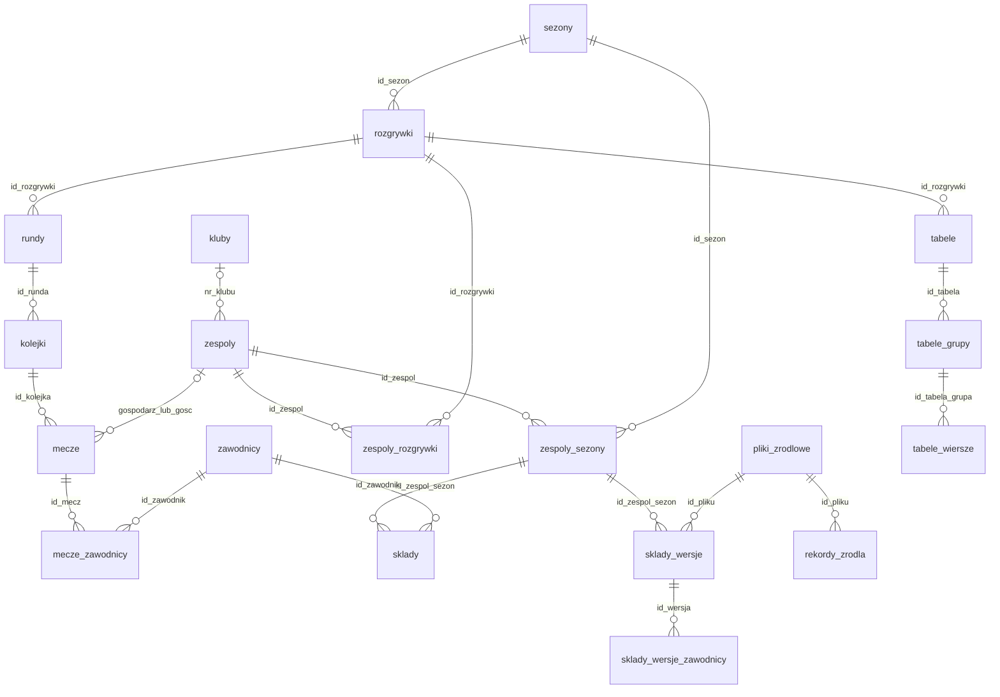

# Relacje i różnice względem projektu SQL

[Przegląd bazy](README.md) — [Public](PUBLIC_SCHEMA.md) — [Logs](LOGS_SCHEMA.md)

Stan metadanych: 2026-09-12T19:13:51.748319+02:00. Diagram jest skrótem relacji potwierdzonych kluczami obcymi; pełne definicje znajdują się niżej.

## Główne relacje

Relacja zespoly–mecze przedstawia skrótowo dwa niezależne, opcjonalne FK: gospodarza i gościa. Diagram nie zastępuje złożonych FK kontrolujących zgodność sezonu i rozgrywek.

## Konsekwencje dla aplikacji

- Mecze mają bezpośrednie id_sezon, id_rozgrywki i id_kolejka. Złożone FK spinają je ze sobą; nie łącz kolejki po numerze lub nazwie.
- Drużynę historyczną dobieraj przez zespoly_sezony.id_zespol i zespoly_sezony.id_sezon. Wewnętrzne zespoly_sezony.id jest bigint; nie utożsamiaj go z id_api.
- Dla listy meczów używaj LEFT JOIN na obu drużynach i hali, bo FK dopuszczają NULL.
- Klucz mecze_zawodnicy to (id_mecz, strona, id_zawodnik). Agregując, świadomie obsłuż stronę inne i wpisy zawodnika po kilku stronach.
- Zespoly_sezony.id_wersja_skladu jest opcjonalne. Złożony FK (id_wersja_skladu, id) wskazuje sklady_wersje(id, id_zespol_sezon), pilnując właściciela wersji. Wersje tworzą relację zwrotną z migawką sezonową.
- Mecze_zawodnicy, mecze_sedziowie, mecze_sztab i załączniki są niezależnymi relacjami jeden-do-wielu. Nie sumuj bramek po ich jednoczesnym JOIN bez wcześniejszej agregacji.
- Strzelcy oraz tabele_wiersze zawierają miejsce i kolejnosc_zrodlowa. Miejsce może być NULL; przed sortowaniem ustal zachowanie dla braków. Nie odtwarzaj automatycznie oficjalnej punktacji z samych wyników.
- Rekordy_zrodla przechowuje nazwę tabeli i klucz JSON. Nie ma FK do dowolnej tabeli domenowej, więc jest to odsyłacz logiczny, a nie gwarantowana relacja SQL.
- Kluby_zespoly_historia.id_zespol i id_sezon nie mają FK; obecność identyfikatora nie gwarantuje odpowiadającego rekordu słownika.
- Daty meczów są timestamp without time zone, czasy audytu timestamp with time zone. Nie zakładaj, że naiwne terminy są UTC; regułę prezentacji trzeba ustalić przed konwersją.
- Historia *_log zawiera wiele obrazów tego samego rekordu. log_id jest kluczem wpisu historii; log_klucz opisuje klucz obiektu źródłowego.
- Obsługa logs wymaga jawnego kwalifikowania nazw, ponieważ search_path sesji nie zawiera tego schematu.

## Różnice względem db/schema_postgres.sql

Porównano stan bieżący z [archiwalnym plikiem schema_postgres.sql](schema_postgres_archiwalny.sql) (kopia wcześniejszego projektu bazy z katalogu nadrzędnego, stan 2026-09-10). Ten plik nie jest aktualną definicją całej bazy i nie powinien być wykonywany w celu jej odtworzenia. Poniższa lista jest dokumentacją różnic, nie propozycją migracji.

- W pliku SQL jest 27 tabel bez jawnego schematu; public ma obecnie 30 tabel.
- Nowe względem pliku tabele public: pliki_zrodlowe, rekordy_zrodla, sklady_wersje, sklady_wersje_zawodnicy.
- public.import_bledy nie istnieje; aktualny logs.import_bledy ma rozbudowane pola i relacje.
- Cały schemat logs, jego audyt, funkcje oraz widoki nie są opisane w starym SQL.

### Różnice w nazwach kolumn

Lista poniżej porównuje nazwy kolumn wspólnych tabel. Nie jest pełnym porównaniem typów, wartości domyślnych ani ograniczeń.

| Tabela | Obecne w bazie, brak w SQL | W SQL, brak w bazie |
| --- | --- | --- |
| kolejki | id_rozgrywki | — |
| licencje_klubowe | klucz_zrodlowy, sezon_nazwa | — |
| mecze | rozgrywki_code | — |
| mecze_sedziowie | miasto, nazwisko | — |
| mecze_sztab | imie, licencja, nazwisko | — |
| mecze_zawodnicy | imie, nazwisko | — |
| osoby_sztabu | id_api | licencja |
| strzelcy | id_pliku, kolejnosc_zrodlowa, miejsce | — |
| tabele_wiersze | id_pliku, kolejnosc_zrodlowa, miejsce | — |
| zespoly_rozgrywki | id_sezon | — |
| zespoly_sezony | id_api, id_wersja_skladu | — |

### Istotne różnice kluczy i typów

- mecze_zawodnicy: stary PK (id_mecz, id_zawodnik), bieżący PK (id_mecz, strona, id_zawodnik).
- zespoly_sezony.id: w SQL integer jako źródłowy identyfikator; obecnie bigint i oddzielne opcjonalne id_api. sklady.id_zespol_sezon ma obecnie bigint.
- mecze.id_zespol_gosp i id_zespol_gosc: w SQL NOT NULL, obecnie dopuszczają NULL.
- Baza ma dodatkowe złożone FK zapewniające spójność meczu, kolejki, rundy, rozgrywek i sezonu oraz udziału drużyny. Część jest DEFERRABLE.
- Baza ma dodatkowe reguły unikalności, w tym UNIQUE NULLS NOT DISTINCT dla hal, załączników i wpisów sztabu.
- Dodatkowe CHECK i triggery chronią zakres seniorów, źródła, historię i kontekst danych. Dokładne definicje są w słownikach schematów.

## Wszystkie klucze obce

Wykaz obejmuje 68 rzeczywistych FK. Relacje logiczne bez FK nie są tutaj dodawane. Definicja PostgreSQL pokazuje między innymi kolumny i DEFERRABLE; pełny cel jest jawnie wskazany w osobnej kolumnie. Pominięte w definicji ON UPDATE/ON DELETE oznaczają domyślne NO ACTION, nie CASCADE.

| źródło | Nazwa FK | Cel | Definicja |
| --- | --- | --- | --- |
| logs.anomalie_danych | anomalie_danych_id_pliku_fkey | public.pliki_zrodlowe | `FOREIGN KEY (id_pliku) REFERENCES pliki_zrodlowe(id)` |
| logs.anomalie_danych | anomalie_danych_id_przebieg_fkey | logs.import_przebiegi | `FOREIGN KEY (id_przebieg) REFERENCES logs.import_przebiegi(id)` |
| logs.import_bledy | import_bledy_id_import_pliku_fkey | logs.import_pliki | `FOREIGN KEY (id_import_pliku) REFERENCES logs.import_pliki(id)` |
| logs.import_bledy | import_bledy_id_pliku_fkey | public.pliki_zrodlowe | `FOREIGN KEY (id_pliku) REFERENCES pliki_zrodlowe(id)` |
| logs.import_bledy | import_bledy_id_przebieg_fkey | logs.import_przebiegi | `FOREIGN KEY (id_przebieg) REFERENCES logs.import_przebiegi(id)` |
| logs.import_pliki | import_pliki_id_pliku_fkey | public.pliki_zrodlowe | `FOREIGN KEY (id_pliku) REFERENCES pliki_zrodlowe(id)` |
| logs.import_pliki | import_pliki_id_przebieg_fkey | logs.import_przebiegi | `FOREIGN KEY (id_przebieg) REFERENCES logs.import_przebiegi(id)` |
| logs.pobrania | pobrania_id_pliku_fkey | public.pliki_zrodlowe | `FOREIGN KEY (id_pliku) REFERENCES pliki_zrodlowe(id)` |
| logs.pobrania | pobrania_id_przebieg_fkey | logs.import_przebiegi | `FOREIGN KEY (id_przebieg) REFERENCES logs.import_przebiegi(id)` |
| logs.zdarzenia | zdarzenia_id_import_pliku_fkey | logs.import_pliki | `FOREIGN KEY (id_import_pliku) REFERENCES logs.import_pliki(id)` |
| logs.zdarzenia | zdarzenia_id_pobranie_fkey | logs.pobrania | `FOREIGN KEY (id_pobranie) REFERENCES logs.pobrania(id)` |
| logs.zdarzenia | zdarzenia_id_przebieg_fkey | logs.import_przebiegi | `FOREIGN KEY (id_przebieg) REFERENCES logs.import_przebiegi(id)` |
| public.kluby | kluby_nr_wzpr_fkey | public.zwiazki_wojewodzkie | `FOREIGN KEY (nr_wzpr) REFERENCES zwiazki_wojewodzkie(nr_wzpr)` |
| public.kluby_zespoly_historia | kluby_zespoly_historia_nr_klubu_fkey | public.kluby | `FOREIGN KEY (nr_klubu) REFERENCES kluby(nr_klubu)` |
| public.kolejki | kolejki_id_runda_fkey | public.rundy | `FOREIGN KEY (id_runda) REFERENCES rundy(id)` |
| public.kolejki | kolejki_id_runda_id_rozgrywki_fkey | public.rundy | `FOREIGN KEY (id_runda, id_rozgrywki) REFERENCES rundy(id, id_rozgrywki) DEFERRABLE` |
| public.licencje_klubowe | licencje_klubowe_id_sezon_fkey | public.sezony | `FOREIGN KEY (id_sezon) REFERENCES sezony(id)` |
| public.licencje_klubowe | licencje_klubowe_nr_klubu_fkey | public.kluby | `FOREIGN KEY (nr_klubu) REFERENCES kluby(nr_klubu)` |
| public.mecze | mecze_id_hala_fkey | public.hale | `FOREIGN KEY (id_hala) REFERENCES hale(id)` |
| public.mecze | mecze_id_kolejka_fkey | public.kolejki | `FOREIGN KEY (id_kolejka) REFERENCES kolejki(id)` |
| public.mecze | mecze_id_kolejka_id_rozgrywki_fkey | public.kolejki | `FOREIGN KEY (id_kolejka, id_rozgrywki) REFERENCES kolejki(id, id_rozgrywki) DEFERRABLE` |
| public.mecze | mecze_id_rozgrywki_fkey | public.rozgrywki | `FOREIGN KEY (id_rozgrywki) REFERENCES rozgrywki(id)` |
| public.mecze | mecze_id_rozgrywki_id_sezon_fkey | public.rozgrywki | `FOREIGN KEY (id_rozgrywki, id_sezon) REFERENCES rozgrywki(id, id_sezon) DEFERRABLE` |
| public.mecze | mecze_id_sezon_fkey | public.sezony | `FOREIGN KEY (id_sezon) REFERENCES sezony(id)` |
| public.mecze | mecze_id_zespol_gosc_fkey | public.zespoly | `FOREIGN KEY (id_zespol_gosc) REFERENCES zespoly(id)` |
| public.mecze | mecze_id_zespol_gosc_id_rozgrywki_fkey | public.zespoly_rozgrywki | `FOREIGN KEY (id_zespol_gosc, id_rozgrywki) REFERENCES zespoly_rozgrywki(id_zespol, id_rozgrywki) DEFERRABLE` |
| public.mecze | mecze_id_zespol_gosp_fkey | public.zespoly | `FOREIGN KEY (id_zespol_gosp) REFERENCES zespoly(id)` |
| public.mecze | mecze_id_zespol_gosp_id_rozgrywki_fkey | public.zespoly_rozgrywki | `FOREIGN KEY (id_zespol_gosp, id_rozgrywki) REFERENCES zespoly_rozgrywki(id_zespol, id_rozgrywki) DEFERRABLE` |
| public.mecze | mecze_id_zespol_walkower_fkey | public.zespoly | `FOREIGN KEY (id_zespol_walkower) REFERENCES zespoly(id)` |
| public.mecze | mecze_id_zespol_wycofany_fkey | public.zespoly | `FOREIGN KEY (id_zespol_wycofany) REFERENCES zespoly(id)` |
| public.mecze_sedziowie | mecze_sedziowie_id_mecz_fkey | public.mecze | `FOREIGN KEY (id_mecz) REFERENCES mecze(id)` |
| public.mecze_sedziowie | mecze_sedziowie_id_sedzia_fkey | public.sedziowie | `FOREIGN KEY (id_sedzia) REFERENCES sedziowie(id)` |
| public.mecze_sztab | mecze_sztab_id_mecz_fkey | public.mecze | `FOREIGN KEY (id_mecz) REFERENCES mecze(id)` |
| public.mecze_sztab | mecze_sztab_id_osoba_fkey | public.osoby_sztabu | `FOREIGN KEY (id_osoba) REFERENCES osoby_sztabu(id)` |
| public.mecze_zalaczniki | mecze_zalaczniki_id_mecz_fkey | public.mecze | `FOREIGN KEY (id_mecz) REFERENCES mecze(id)` |
| public.mecze_zawodnicy | mecze_zawodnicy_id_mecz_fkey | public.mecze | `FOREIGN KEY (id_mecz) REFERENCES mecze(id)` |
| public.mecze_zawodnicy | mecze_zawodnicy_id_zawodnik_fkey | public.zawodnicy | `FOREIGN KEY (id_zawodnik) REFERENCES zawodnicy(id)` |
| public.pliki_zrodlowe | pliki_zrodlowe_id_rozgrywki_fkey | public.rozgrywki | `FOREIGN KEY (id_rozgrywki) REFERENCES rozgrywki(id)` |
| public.pliki_zrodlowe | pliki_zrodlowe_id_sezon_fkey | public.sezony | `FOREIGN KEY (id_sezon) REFERENCES sezony(id)` |
| public.rekordy_zrodla | rekordy_zrodla_id_pliku_fkey | public.pliki_zrodlowe | `FOREIGN KEY (id_pliku) REFERENCES pliki_zrodlowe(id)` |
| public.rozgrywki | rozgrywki_id_sezon_fkey | public.sezony | `FOREIGN KEY (id_sezon) REFERENCES sezony(id)` |
| public.rozgrywki | rozgrywki_nr_wzpr_fkey | public.zwiazki_wojewodzkie | `FOREIGN KEY (nr_wzpr) REFERENCES zwiazki_wojewodzkie(nr_wzpr)` |
| public.rundy | rundy_id_rozgrywki_fkey | public.rozgrywki | `FOREIGN KEY (id_rozgrywki) REFERENCES rozgrywki(id)` |
| public.sklady | sklady_id_pozycja_fkey | public.pozycje | `FOREIGN KEY (id_pozycja) REFERENCES pozycje(id)` |
| public.sklady | sklady_id_zawodnik_fkey | public.zawodnicy | `FOREIGN KEY (id_zawodnik) REFERENCES zawodnicy(id)` |
| public.sklady | sklady_id_zespol_sezon_fkey | public.zespoly_sezony | `FOREIGN KEY (id_zespol_sezon) REFERENCES zespoly_sezony(id)` |
| public.sklady_wersje | sklady_wersje_id_pliku_fkey | public.pliki_zrodlowe | `FOREIGN KEY (id_pliku) REFERENCES pliki_zrodlowe(id)` |
| public.sklady_wersje | sklady_wersje_id_zespol_sezon_fkey | public.zespoly_sezony | `FOREIGN KEY (id_zespol_sezon) REFERENCES zespoly_sezony(id)` |
| public.sklady_wersje_zawodnicy | sklady_wersje_zawodnicy_id_wersja_fkey | public.sklady_wersje | `FOREIGN KEY (id_wersja) REFERENCES sklady_wersje(id)` |
| public.sklady_wersje_zawodnicy | sklady_wersje_zawodnicy_id_zawodnik_fkey | public.zawodnicy | `FOREIGN KEY (id_zawodnik) REFERENCES zawodnicy(id)` |
| public.strzelcy | strzelcy_id_pliku_fkey | public.pliki_zrodlowe | `FOREIGN KEY (id_pliku) REFERENCES pliki_zrodlowe(id)` |
| public.strzelcy | strzelcy_id_rozgrywki_fkey | public.rozgrywki | `FOREIGN KEY (id_rozgrywki) REFERENCES rozgrywki(id)` |
| public.strzelcy | strzelcy_id_zawodnik_fkey | public.zawodnicy | `FOREIGN KEY (id_zawodnik) REFERENCES zawodnicy(id)` |
| public.strzelcy | strzelcy_id_zespol_fkey | public.zespoly | `FOREIGN KEY (id_zespol) REFERENCES zespoly(id)` |
| public.tabele | tabele_id_rozgrywki_fkey | public.rozgrywki | `FOREIGN KEY (id_rozgrywki) REFERENCES rozgrywki(id)` |
| public.tabele_grupy | tabele_grupy_id_tabela_fkey | public.tabele | `FOREIGN KEY (id_tabela) REFERENCES tabele(id)` |
| public.tabele_wiersze | tabele_wiersze_id_pliku_fkey | public.pliki_zrodlowe | `FOREIGN KEY (id_pliku) REFERENCES pliki_zrodlowe(id)` |
| public.tabele_wiersze | tabele_wiersze_id_tabela_grupa_fkey | public.tabele_grupy | `FOREIGN KEY (id_tabela_grupa) REFERENCES tabele_grupy(id)` |
| public.tabele_wiersze | tabele_wiersze_id_zespol_fkey | public.zespoly | `FOREIGN KEY (id_zespol) REFERENCES zespoly(id)` |
| public.zespoly | zespoly_nr_klubu_fkey | public.kluby | `FOREIGN KEY (nr_klubu) REFERENCES kluby(nr_klubu)` |
| public.zespoly_rozgrywki | zespoly_rozgrywki_id_rozgrywki_fkey | public.rozgrywki | `FOREIGN KEY (id_rozgrywki) REFERENCES rozgrywki(id)` |
| public.zespoly_rozgrywki | zespoly_rozgrywki_id_rozgrywki_id_sezon_fkey | public.rozgrywki | `FOREIGN KEY (id_rozgrywki, id_sezon) REFERENCES rozgrywki(id, id_sezon) DEFERRABLE` |
| public.zespoly_rozgrywki | zespoly_rozgrywki_id_zespol_fkey | public.zespoly | `FOREIGN KEY (id_zespol) REFERENCES zespoly(id)` |
| public.zespoly_rozgrywki | zespoly_rozgrywki_id_zespol_id_sezon_fkey | public.zespoly_sezony | `FOREIGN KEY (id_zespol, id_sezon) REFERENCES zespoly_sezony(id_zespol, id_sezon) DEFERRABLE` |
| public.zespoly_sezony | zespoly_sezony_id_sezon_fkey | public.sezony | `FOREIGN KEY (id_sezon) REFERENCES sezony(id)` |
| public.zespoly_sezony | zespoly_sezony_id_wersja_skladu_id_fkey | public.sklady_wersje | `FOREIGN KEY (id_wersja_skladu, id) REFERENCES sklady_wersje(id, id_zespol_sezon) DEFERRABLE` |
| public.zespoly_sezony | zespoly_sezony_id_zespol_fkey | public.zespoly | `FOREIGN KEY (id_zespol) REFERENCES zespoly(id)` |
| public.zespoly_sezony | zespoly_sezony_nr_klubu_fkey | public.kluby | `FOREIGN KEY (nr_klubu) REFERENCES kluby(nr_klubu)` |
